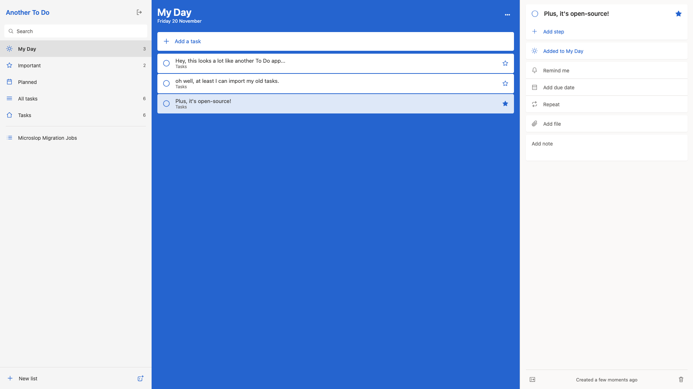

# Another To Do

> [!CAUTION]
> This software is in alpha. Any data you submit to the live demo may be retained and viewed by the maintainers. Use this software at your own risk!

Welcome to Another To Do (ATD)! This is designed to be a replacement for Microsoft To Do, which is closing in June 2027.



Check out the [live demo](https://itsanothertodo.app/).

## Components

### API

Designed to run serverless for minimal cost, or as a single Docker container.

- REST (Express on Amazon Lambda Web Functions, or in a container)
- Sign in with Amazon Cognito, with usernames and passwords, or with Microsoft
- MCP

The logic is independent of where it runs: databases, file storage, authentication and real time delivery are swappable providers (DynamoDB, S3, Cognito and API Gateway on AWS; SQLite, local disk and WebSockets in Docker).

### Client

Expo/React Native client for managing your tasks.

Supports web, iOS, Android, [macOS](https://microsoft.github.io/react-native-macos/) and [Windows](https://microsoft.github.io/react-native-windows/).

## Hosting

Pick one of two ways to run your own server.

### Option 1: Docker

One container runs the API, a SQLite database, photo storage, real time updates and the web app.

```sh
git clone https://github.com/oliverphardman/another-todo.git
cd another-todo
ADMIN_PASSWORD='choose-a-password' docker compose up -d
```

Open http://localhost:3000 and sign in as `admin`. Your data lives in the `data` volume, so back it up. For a public server, put the container behind a reverse proxy that terminates HTTPS and forwards WebSockets, then set `PUBLIC_API_URL` to your address.

See [docs/self-hosting.md](docs/self-hosting.md) for all the settings and [docs/azure-app-registration.md](docs/azure-app-registration.md) to enable Sign in with Microsoft.

### Option 2: AWS (serverless)

Runs the API on an Amazon Lambda Web Function with DynamoDB, S3, Cognito and an API Gateway WebSocket API, and the web app on S3 and CloudFront. You need an AWS account, a domain you can delegate to Route 53, and Terraform, Node.js, pnpm and the AWS CLI installed.

1. Create the Terraform state bucket (run once; this keeps local state):

   ```sh
   cd infra/bootstrap
   terraform init && terraform apply
   ```

2. Point `backend "s3"` in `infra/main.tf` at your own state bucket, and set `domain_name` (plus any other variables in `infra/variables.tf`, such as `enforced_username` and `server_notice`) in a `terraform.tfvars` file. Set `manage_azure_app = false` unless you are signed in to Azure and want Microsoft sign-in created for you.

3. Build the API and deploy the infrastructure:

   ```sh
   pnpm install
   pnpm --dir apps/api run build
   cd infra
   terraform init && terraform apply
   ```

4. Delegate your domain to the `name_servers` output at your registrar. Web Functions are only available in us-east-1, us-east-2, us-west-2, ap-northeast-1 and eu-west-1.

5. Build and upload the web app:

   ```sh
   infra/deploy-web.sh
   ```

By default Terraform serves everyone as the single `enforced_username` user. Set `enforced_username` to an empty string to require Cognito sign-in instead. To deploy on every push to `main`, see `.github/workflows/deploy.yml`.

## Features

- Sign in with a custom login or using a Microsoft account
- Signing in with Microsoft offers to import your Microsoft To Do lists and tasks, and keeps them in sync while the app is open
- Attach files to tasks
- Works offline
